# 📊 UIII Act3: Importación y Descripción de Datos
## Daniel Gallegos NC 1392
> **🎓 Asignatura:** Soluciona problemas de Machine Learning  
> **📚 Nivel:** Tercer semestre de preparatoria  
> **🤖 Especialidad:** Inteligencia Artificial  
> **📈 Dificultad:** Cero a principiante  
> **🐍 Lenguaje:** Python  
> **🛠️ Herramientas:** Visual Studio Code, Pandas, Matplotlib y CSV  
## Libros de Biblioteca
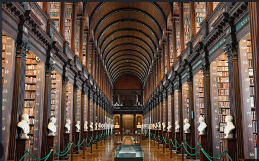
## TABLA ORIGINAL DE LIBROS
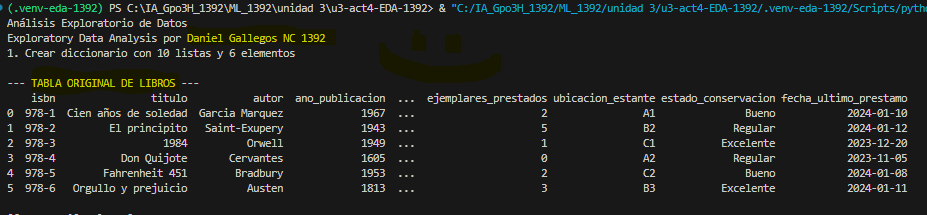
## Convertir el DataFrame en archivo CSV
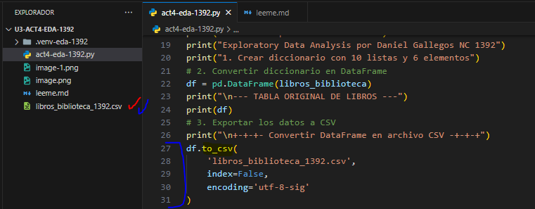
## Datos del CSV --> Base de datos

## Leer los datos del archivo CSV
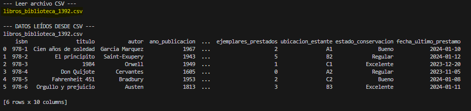
## Análisis Exploratorio de Datos (EDA)

## Dimensiones y estructura
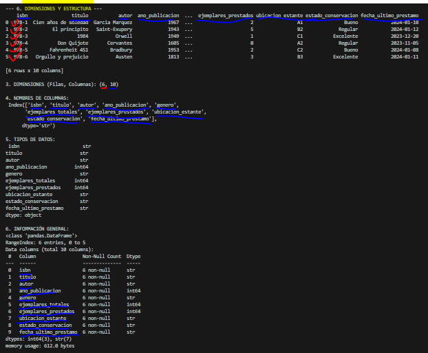
## Estadísticas y limpieza

## Ordenamiento, filtrado y agrupacion
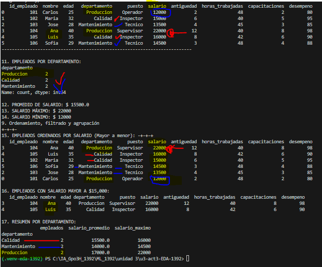
## Gráfica de barras: Libros por genero
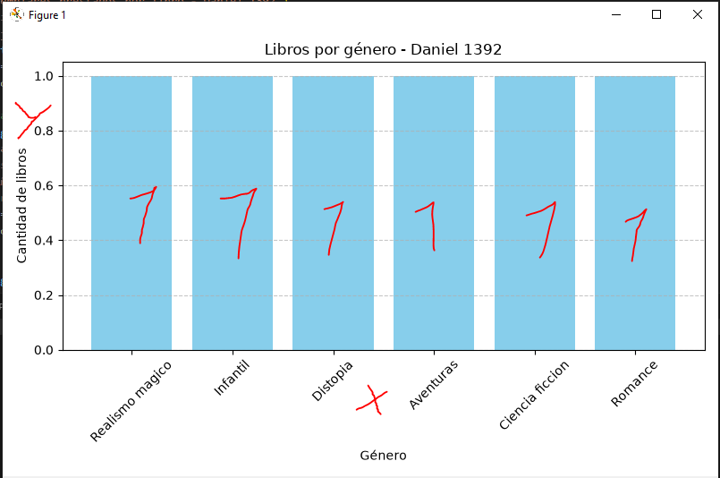
## Gráfica de barras: Ejemplares prestados por libro
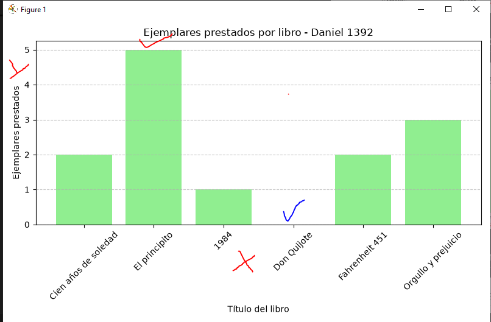
## Histograma: Distribución de años de publicacion
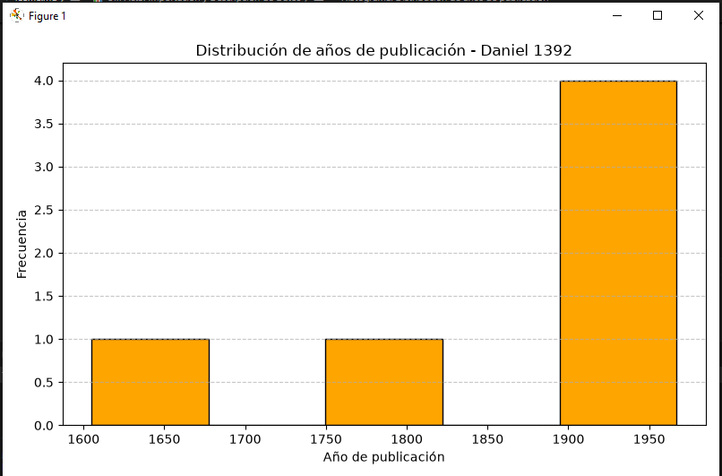
## Gráfica de dispersión: Ejemplares totales vs prestados
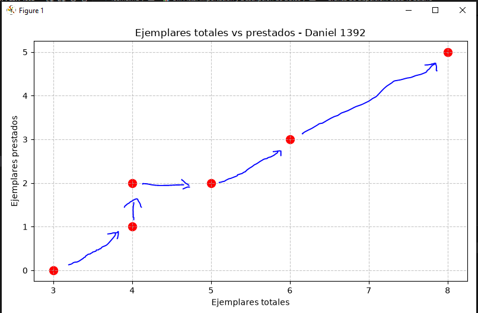
## Diagrama de caja: Distribución de ejemplares totales
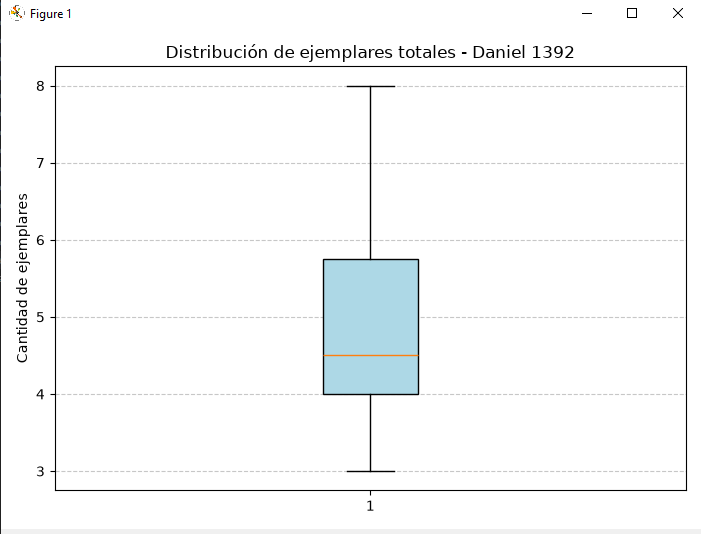
## Matriz de correlación
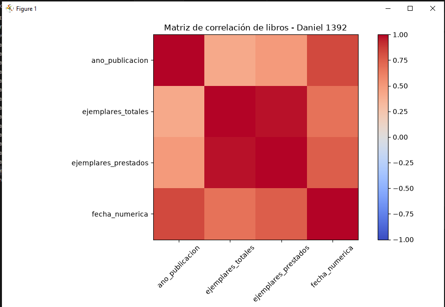